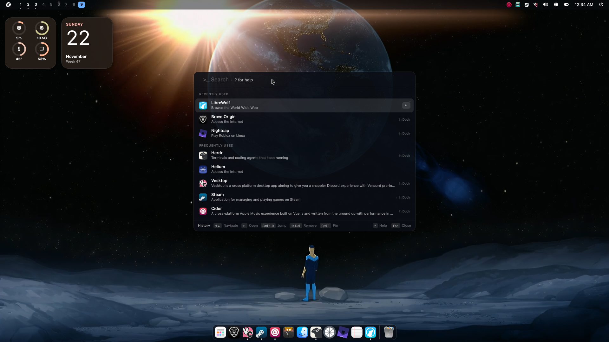
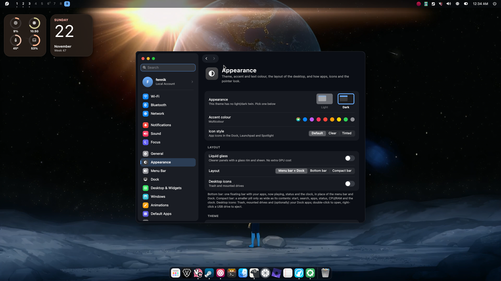

# Island

Island is a macOS-style desktop shell for Wayland, built on [Quickshell](https://quickshell.org): a menu bar, dock, desktop widgets, Spotlight, Launchpad, Overview, Control Centre, notifications, System Settings and a lock screen, all in one Quickshell process. A matching SDDM login theme and a palette pipeline that recolours the rest of the desktop are included. It runs on Hyprland, niri, Sway/SwayFX/Scroll and MangoWC, with sensible fallbacks on any compositor that speaks layer-shell, foreign-toplevel and ext-session-lock.


> [!WARNING]
> This is a personal setup, vibecoded. Paths and preferences are tuned for one machine. Use it, fork it, take parts of it, but expect rough edges.

# PRs are welcome and Issues too!

## Components

| Name | What it does | Config path |
|---|---|---|
| Shell | Bar, dock, widgets, overlays, popouts, Settings and lock in one process | `shell.qml`, `bar/`, `dock/`, `widgets/`, `overlays/`, `popouts/`, `settings/` |
| Menu bar | App menus, workspace indicator, tray, status, weather, clock | `bar/` |
| Dock | Magnification, launch bounce, pinning, trash, autohide | `dock/Dock.qml` |
| Spotlight and Launchpad | Apps, files, math, `>` commands, web search, app grid | `overlays/Spotlight.qml`, `overlays/Launchpad.qml` |
| Overview | Workspace and window overview with live previews | `overlays/Overview.qml` |
| Control Centre | Wi-Fi, Bluetooth, sound, brightness, media, DND, caffeine | `popouts/ControlCenter.qml` |
| Notifications | Notification daemon and Notification Centre | `services/Notifs.qml`, `popouts/Notifications.qml` |
| System Settings | Live settings window for shell and compositor | `settings/` |
| Lock screen | ext-session-lock locker with PAM authentication | `overlays/Lock.qml`, `overlays/LockContent.qml` |
| SDDM login | Matching greeter theme and installer | `sddm/` |
| Themes | 21 palettes plus generated Material You theme | `themes/*.json`, `apply-theme.sh` |
| Settings pipeline | Pushes settings to the compositor, GTK, Foot, cursor and icons | `apply-settings.sh` |
| Wallpapers | Image and video wallpapers, picker, Wallhaven | `scripts/wallpaper-set.sh`, `scripts/wallhaven.sh` |
| Compositor glue | Autostart, keybinds and layer rules | `examples/<compositor>/` |
| Session scripts | Startup, power/session actions and a dbus session wrapper | `scripts/island-startup`, `scripts/island-power`, `scripts/island-session` |

## Quick start

```sh
git clone https://github.com/ItsFennik/island-dots ~/.config/quickshell/island
cd ~/.config/quickshell/island
./install.sh --dry-run
./install.sh
```

Add one autostart line to your compositor, using the matching file in [`examples/`](examples/):

```sh
# Hyprland
exec-once = ~/.config/quickshell/island/scripts/island-startup
# niri
spawn-at-startup "sh" "-c" "~/.config/quickshell/island/scripts/island-startup"
# Sway
exec ~/.config/quickshell/island/scripts/island-startup
# MangoWC
exec-once=~/.config/quickshell/island/scripts/island-startup
```

Then log out and back in, or run the startup script by hand.

systemd is not required. The startup script creates the runtime directory, starts a dbus session when needed, starts PipeWire and WirePlumber when no user service manager exists, and starts the clipboard watchers, wallpaper and Quickshell. See [docs/non-systemd.md](docs/non-systemd.md).

## Documentation

- [Install](docs/installation.md): per-distribution guides from packages to a running shell
- [Theming](docs/theming.md): palettes and what `apply-theme.sh` touches
- [Components](docs/components/index.md): one page per surface
- [Keybinds](docs/keybinds.md)
- [Non-systemd](docs/non-systemd.md)
- [Troubleshooting](docs/troubleshooting.md)
- [FAQ](docs/faq.md)
- [Contributing](docs/contributing.md)

## Screenshots

| | |
|---|---|
|  |  |
|  |  |
|  |  |

More are in [docs/screenshots](docs/screenshots/). The capture script is [docs/screenshots/capture.sh](docs/screenshots/capture.sh); files that still need to be taken are listed in [SHOTS_NEEDED.md](docs/screenshots/SHOTS_NEEDED.md).

## Credits

Quickshell supplies the shell runtime. The ride is inspired by macOS and by the work of the Wayland bar and shell community: Hyprland, niri, Sway, MangoWC, Quickshell examples, adw-gtk3, matugen, Catppuccin, Nord, Gruvbox, Rosé Pine, Tokyo Night, Kanagawa, Everforest, Nerd Fonts, WhiteSur icons, and the Linux desktop projects that make this stack possible.

## License

[AGPL-3.0](LICENSE).
