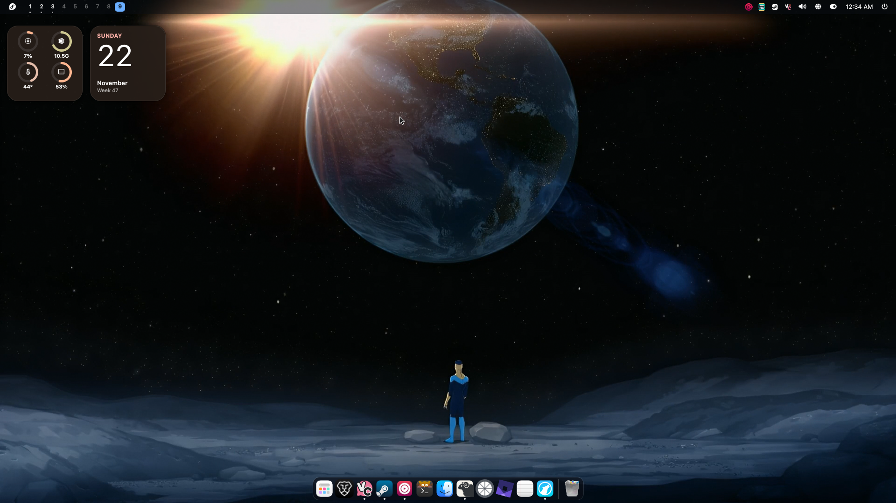
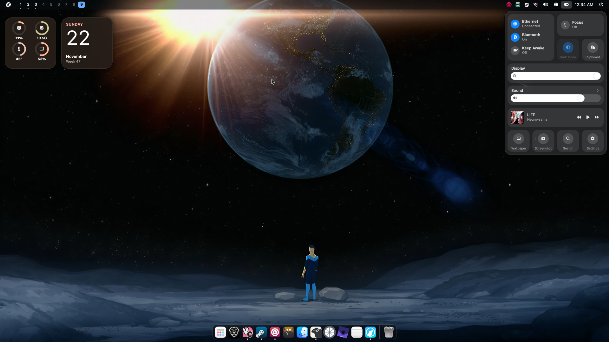
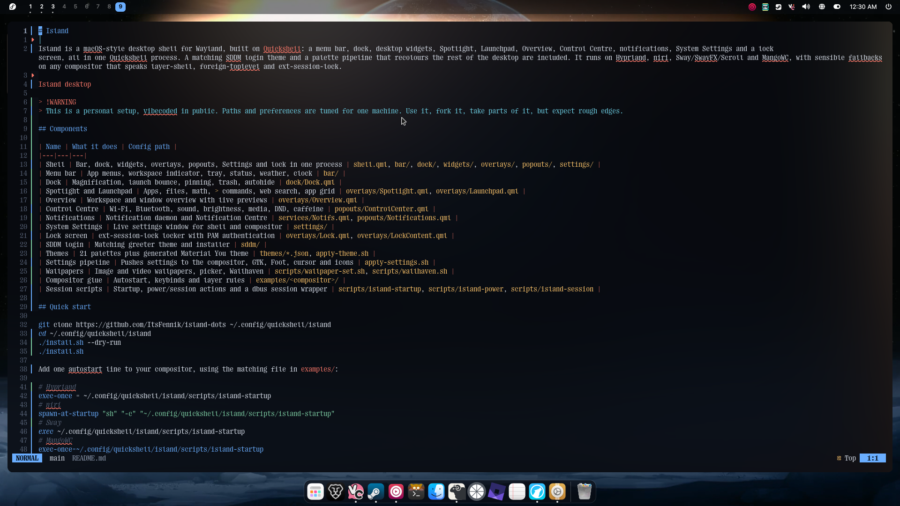

# Island

Island is a macOS-style desktop shell for Wayland, built on [Quickshell](https://quickshell.org): a menu bar, dock, desktop widgets, Launchpad, Overview, Control Centre, notifications and a lock screen in one Quickshell process, with Spotlight and System Settings as small Rust/GTK4 companions. A matching SDDM login theme and a palette pipeline that recolours the rest of the desktop are included. It runs on Hyprland, niri, Sway/SwayFX/Scroll and MangoWC, with sensible fallbacks on any compositor that speaks layer-shell, foreign-toplevel and ext-session-lock.



> [!WARNING]
> This is a personal setup, vibecoded. Paths and preferences are tuned for one machine. Use it, fork it, take parts of it, but expect rough edges.

# PRs are welcome and Issues too!

## Components

| Name | What it does | Config path |
|---|---|---|
| Shell | Bar, dock, widgets, overlays, popouts and lock in one process | `shell.qml`, `bar/`, `dock/`, `widgets/`, `overlays/`, `popouts/` |
| Menu bar | App menus, workspace indicator, tray, status, weather, clock | `bar/` |
| Dock | Magnification, launch bounce, pinning, trash, autohide | `dock/Dock.qml` |
| Spotlight and Launchpad | Apps, files, math, `>` commands, web search and history (Rust); app grid (QML) | `rust/`, `overlays/Launchpad.qml` |
| Overview | Workspace and window overview with live previews | `overlays/Overview.qml` |
| Control Centre | Wi-Fi, Bluetooth, sound, brightness, media, DND, caffeine | `popouts/ControlCenter.qml` |
| Notifications | Notification daemon and Notification Centre | `services/Notifs.qml`, `popouts/Notifications.qml` |
| System Settings | Rust/GTK4 settings for the shell, with every pane native; the QML `settings/` tree is the source of truth for the port | `rust/`, `settings/` |
| Lock screen | ext-session-lock locker with PAM authentication, animated typing and circles/last-letter/letters password styles | `overlays/Lock.qml`, `overlays/LockContent.qml` |
| SDDM login | Matching greeter theme and installer | `sddm/` |
| Themes | 20 palettes plus a generated Material You theme | `themes/*.json`, `apply-theme.sh` |
| Settings pipeline | Pushes settings to the compositor, GTK, Foot, cursor and icons | `apply-settings.sh` |
| Wallpapers | Image and video wallpapers, picker, Wallhaven | `scripts/wallpaper-set.sh`, `scripts/wallhaven.sh` |
| Compositor glue | Autostart, keybinds and layer rules | `examples/<compositor>/` |
| Session scripts | Startup, power/session actions and a dbus session wrapper | `scripts/island-startup`, `scripts/island-power`, `scripts/island-session` |

## Requirements

- Quickshell 0.3 or newer, on a working Wayland session. Island is a shell, not a compositor.
- `jq`, `curl`, `gdbus` (glib2), `gio` and `notify-send`.
- NetworkManager, BlueZ, PipeWire and UPower for the Control Centre.
- Fonts: Adwaita Sans for the UI and JetBrainsMono Nerd Font for glyphs. WhiteSur icons are the default; any icon theme works.
- Optional: `cliphist` and `wl-clipboard` (clipboard history), `awww` or `swww` (wallpapers), `mpvpaper` and `ffmpeg` (video wallpapers), `matugen` (wallpaper colours), `ddcutil` (monitor brightness), `foot` or `kitty`, `sddm` (login theme).
- Building the Rust UI needs a Rust toolchain and the GTK4 development files. The gtk4-layer-shell runtime library is enough for the rest; `./rust/build.sh` creates the pkg-config shim for it.

Per-distribution package commands are in [docs/installation.md](docs/installation.md).

## Quick start

```sh
git clone https://github.com/ItsFennik/island-dots ~/.config/quickshell/island
cd ~/.config/quickshell/island
./install.sh --dry-run
./install.sh
```

Add one autostart line to your compositor, using the matching file in [`examples/`](examples/):

```sh
# Hyprland
exec-once = ~/.config/quickshell/island/scripts/island-startup
# niri
spawn-at-startup "sh" "-c" "~/.config/quickshell/island/scripts/island-startup"
# Sway
exec ~/.config/quickshell/island/scripts/island-startup
# MangoWC
exec-once=~/.config/quickshell/island/scripts/island-startup
```

Then log out and back in, or run the startup script by hand.

systemd is not required. The startup script creates the runtime directory, starts a dbus session when needed, starts PipeWire and WirePlumber when no user service manager exists, and starts the clipboard watchers, wallpaper and Quickshell. See [docs/non-systemd.md](docs/non-systemd.md).

## Rust UI

Spotlight and Settings are standalone Rust/GTK4 binaries that read the same
`~/.config/island/settings.json` and `themes/*.json` as the shell:

```sh
./rust/build.sh
```

The script installs `island-spotlight` and `island-settings` into `~/.local/bin`
and creates a user-local `gtk4-layer-shell` pkg-config shim when the distribution
ships only the runtime library. Super+D, the bar icons, the dock and the
`qs -c island ipc call launcher`/`settings` targets all launch the Rust binaries.
Every pane, including Wi-Fi, Bluetooth, network, sound, displays, drives and default
apps, is native in the Rust Settings window. The QML tree in `settings/` is kept as the
source of truth for the port, not as a second Settings surface.

## IPC

Every action is an IPC call, so the same command works from keybinds, scripts and the terminal:

```sh
qs -c island ipc call <target> <function> [args]
```

| Target | Functions |
|---|---|
| `launcher` | `toggle`, `open`, `close` |
| `launchpad` | `toggle`, `close` |
| `overview` | `toggle`, `open`, `close` |
| `menu` | `launcher`, `notifs`/`dash`, `system`, `app`, `controls`, `media`, `clipboard`, `power`, `sound`, `bluetooth`, `network`, `close` |
| `picker` | `wallpapers`, `wallhaven`, `themes`, `toggle`, `close` |
| `settings` | `toggle`, `open`, `close`, `page NAME`, `set KEY VALUE`, `get KEY` |
| `notifs` | `toggle`, `dnd`, `clear`, `dismiss` |
| `media` | `toggle`, `playPause`, `next`, `previous`, `stop`, `status` |
| `weather` | `toggle`, `refresh`, `location PLACE`, `units c\|f`, `status` |
| `volume` | `up`, `down`, `mute` |
| `widgets` | `toggle`, `show`, `hide`, `edit`, `reset`, `style` |
| `dock` | `toggle`, `autohide` |
| `lock` | `lock`, `preview`, `previewOff`, `previewOpen`, `status` |
| `screenshot` | `toolbar`, `region`, `window`, `screen`, `all` |
| `tray` | `list`, `menu N` |
| `bar` | `skin NAME`, `next`, `previous` |
| `caffeine` | `toggle` |
| `shell` | `reload` |

The keybinds shipped in `examples/` use these calls; see [docs/keybinds.md](docs/keybinds.md).

## Documentation

- [Install](docs/installation.md): per-distribution guides from packages to a running shell
- [Theming](docs/theming.md): palettes and what `apply-theme.sh` touches
- [Components](docs/components/index.md): one page per surface
- [Keybinds](docs/keybinds.md)
- [Non-systemd](docs/non-systemd.md)
- [Troubleshooting](docs/troubleshooting.md)
- [FAQ](docs/faq.md)
- [Contributing](docs/contributing.md)

## Screenshots

| | |
|---|---|
|  |  |
|  |  |
|  |  |

More are in [docs/screenshots](docs/screenshots/). The capture script is [docs/screenshots/capture.sh](docs/screenshots/capture.sh); files that still need to be taken are listed in [SHOTS_NEEDED.md](docs/screenshots/SHOTS_NEEDED.md).

## Credits

Quickshell supplies the shell runtime. The ride is inspired by macOS and by the work of the Wayland bar and shell community: Hyprland, niri, Sway, MangoWC, Quickshell examples, adw-gtk3, matugen, Catppuccin, Nord, Gruvbox, Rosé Pine, Tokyo Night, Kanagawa, Everforest, Nerd Fonts, WhiteSur icons, and the Linux desktop projects that make this stack possible.

## License

[AGPL-3.0](LICENSE).
