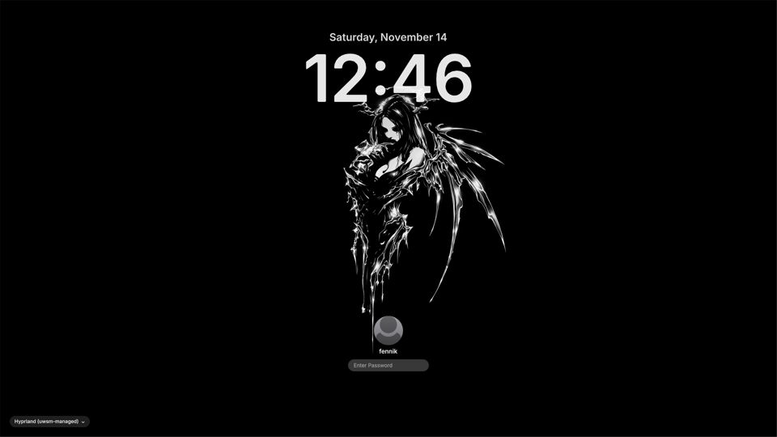

# island-dots

**Island** is a macOS-style desktop shell for Wayland, built on [Quickshell](https://quickshell.org): menu bar, dock, desktop widgets, Spotlight, Launchpad, Control Centre, notifications, System Settings, a lock screen and a matching SDDM login theme. Everything except the login screen runs as a single Quickshell process.

It runs on **Hyprland, niri, Sway/SwayFX/Scroll and MangoWC**. Any other compositor with layer-shell, foreign-toplevel and ext-session-lock (labwc, Wayfire, river, …) gets everything except the window-management menu items.

| Lock screen | Login (SDDM) |
|---|---|
|  |  |

## Features

- **Menu bar**: distro logo menu, the focused app's name and menus, tray, Wi-Fi / Bluetooth / sound / battery, weather, clock. Menus drop down from the bar, and moving across menu titles switches between them, like macOS. Notification banners slide in at the top right.
- **Dock**: pinned and running apps, magnification, bounce on launch, drag to reorder or pin, right-click menu, trash, optional autohide.
- **Desktop widgets**: clock, weather, calendar, now playing (with cover art), system stats.
- **Spotlight** (apps, calculator, `>` commands) and **Launchpad**.
- **Control Centre**: Wi-Fi, Bluetooth, volume, brightness (DDC/CI), media, Do Not Disturb, caffeine.
- **Notifications**: the notification daemon, history, Do Not Disturb.
- **Clipboard history** (cliphist), **wallpaper picker** (images and video), **Wallhaven** browser.
- **Themes**: Catppuccin, Nord, Gruvbox, Rosé Pine, Tokyo Night, Kanagawa, Everforest, monochrome, or Material You from your wallpaper via matugen. A theme also recolours GTK 3/4, compositor borders, Foot and Vesktop.
- **System Settings**: a macOS-style settings app. Changes apply live to the shell, the compositor (gaps, borders, input, cursor, animations), GTK and Foot.
- **Lock screen**: big clock over your wallpaper, picture, name and a password pill. Built on ext-session-lock, so it works on every compositor above.
- **SDDM theme**: the same look for the login screen, with Sleep / Restart / Shut Down and a session picker.

## Compositor support

| | Hyprland | niri | Sway / Scroll | MangoWC | others |
|---|:-:|:-:|:-:|:-:|:-:|
| Bar, dock, widgets, Spotlight, menus | ✓ | ✓ | ✓ | ✓ | ✓ |
| Menus on the focused monitor | ✓ | ✓ | ✓ | ✓ | via focused window |
| Close popups on workspace switch | ✓ | ✓ | ✓ | ext-workspace | ext-workspace |
| Window menu: zoom, full screen, close | ✓ | ✓ | ✓ | ✓ | foreign-toplevel |
| Window menu: float, move to desktop | ✓ | ✓ | ✓ | ✓ | – |
| Lock screen | ✓ | ✓ | ✓ | ✓ | ✓ |
| Settings → compositor (gaps, input, …) | live | `island.kdl` include | live + `island.conf` | – | – |
| Blur behind bar / dock | layer rules | – | SwayFX | – | – |

All of this lives in [`services/Compositor.qml`](services/Compositor.qml). The compositor is detected from `HYPRLAND_INSTANCE_SIGNATURE`, `NIRI_SOCKET`, `SWAYSOCK` / `I3SOCK` and `XDG_CURRENT_DESKTOP`. Hyprland uses focus grabs for "click outside to close". Elsewhere, an open popup covers the screen with a transparent click-catcher instead.

## Requirements

- **Quickshell ≥ 0.3**
- `jq`, `curl`, `gdbus` (glib2), `gio`, `notify-send`
- NetworkManager, BlueZ, PipeWire, UPower (for the Control Centre)
- Fonts: **Adwaita Sans** (UI) and **JetBrainsMono Nerd Font** (glyphs). Icons: WhiteSur (any icon theme works)
- Optional: `cliphist` + `wl-clipboard` (clipboard history), `awww` or `swww` (wallpapers), `mpvpaper` + `ffmpeg` (video wallpapers and thumbnails), `matugen` (Material You colours), `ddcutil` (monitor brightness), `foot`, `sddm` (login theme)

## Install

```sh
git clone https://github.com/ItsFennik/island-dots ~/.config/quickshell/island
qs -c island            # try it; -d to daemonize
```

Then add the autostart lines and keybinds for your compositor:

- Hyprland: [`examples/hyprland/island.lua`](examples/hyprland/island.lua) (Lua config; also has the blur and animation layer rules)
- niri: [`examples/niri/island.kdl`](examples/niri/island.kdl)
- Sway / SwayFX / Scroll: [`examples/sway/island.conf`](examples/sway/island.conf)
- MangoWC: [`examples/mango/island.conf`](examples/mango/island.conf)

Settings live in `~/.config/island/settings.json`, written by System Settings (<kbd>Super</kbd>+<kbd>I</kbd>) and merged over [`defaults.json`](defaults.json).

### Lock screen

Built in, nothing to install. It locks on any of these:

- the logo menu → Lock Screen, or the Power menu
- `qs -c island ipc call lock lock` (bind it, e.g. <kbd>Super</kbd>+<kbd>Ctrl</kbd>+<kbd>Q</kbd>)
- `loginctl lock-session`, so idle daemons work too, e.g. hypridle `lock_cmd = loginctl lock-session` or `swayidle timeout 300 'loginctl lock-session'`

`qs -c island ipc call lock preview` shows the design without locking (click or <kbd>Esc</kbd> to close). It authenticates through PAM's `login` stack, the same one hyprlock uses. Your picture comes from `~/.face.icon`, `~/.face` or AccountsService.

### Login screen (SDDM)

```sh
./sddm/install.sh           # installs the theme and makes SDDM the display manager (asks for sudo)
./sddm/install.sh --theme   # just refresh the theme, e.g. after changing wallpaper
```

The installer copies the theme to `/usr/share/sddm/themes/island`, uses your current Island wallpaper as the background, picks up your picture and clock format, and enables `sddm.service` (it takes over at the next boot). To go back, run `sudo systemctl enable --force greetd.service` (or gdm, lightdm, …).

## IPC

Everything can be driven from keybinds or scripts:

```
qs -c island ipc call launcher toggle              # Spotlight
qs -c island ipc call launchpad toggle
qs -c island ipc call menu <system|app|notifs|controls|media|clipboard|power|close>
qs -c island ipc call picker <wallpapers|wallhaven|themes|toggle|close>
qs -c island ipc call settings <toggle|open|close|page NAME|set KEY VALUE|get KEY>
qs -c island ipc call notifs <toggle|dnd|clear|dismiss>
qs -c island ipc call media <toggle|playPause|next|previous|stop|status>
qs -c island ipc call volume <up|down|mute>
qs -c island ipc call weather <toggle|refresh|location PLACE|units c|f|status>
qs -c island ipc call widgets <toggle|show|hide>
qs -c island ipc call dock <toggle|autohide>
qs -c island ipc call lock <lock|preview|status>
qs -c island ipc call tray <list|menu N>
qs -c island ipc call caffeine toggle
```

## Layout

```
shell.qml            entry point: windows per screen, IPC handlers
bar/  dock/  widgets/  overlays/   the surfaces (overlays: Spotlight, Launchpad, lock screen)
popouts/             everything that drops down from the bar
settings/            System Settings window and its pages
services/            singletons: Compositor, Config, Theme, Media, Audio, Net, Notifs, Weather, …
components/          shared controls (switches, sliders, menus, …)
themes/              colour palettes (one JSON each)
scripts/             wallpaper, Wallhaven, matugen helpers
apply-settings.sh    pushes settings to the compositor, GTK and Foot
apply-theme.sh       pushes a theme to GTK, compositor borders, Foot and Vesktop
sddm/                login theme + installer
examples/            compositor glue
```

## Notes

- Quickshell runs with the software renderer (`QT_QUICK_BACKEND=software`). The bar is small, so this saves about 180 MB of GPU driver memory. Blur is left to the compositor.
- "macOS-style" means the layout and feel. There are no Apple assets: icons come from your icon theme and Nerd Fonts.
