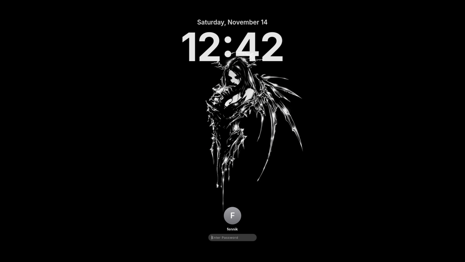

# island-dots

> [!WARNING]
> **This is HEAVILY vibecoded, and it's my personal setup.** I built it for me, my machine and how I like things. You're welcome to use it, fork it or take bits of it, but expect hardcoded paths, my own preferences baked in, rough edges, and features that only got tested on my own setup. Issues and PRs are fine, but I'm not maintaining this for anyone else, so no promises.

**Island** is a macOS-style desktop shell for Wayland, built on [Quickshell](https://quickshell.org): menu bar, dock, desktop widgets, Spotlight, Launchpad, Control Centre, notifications, System Settings, a lock screen and a matching SDDM login theme. Everything except the login screen runs as a single Quickshell process.

It runs on **Hyprland, niri, Sway/SwayFX/Scroll and MangoWC**. Any other compositor with layer-shell, foreign-toplevel and ext-session-lock (labwc, Wayfire, river, …) gets everything except the window-management menu items.

| Lock screen | Login (SDDM) |
|---|---|
|  |  |

## Features

### The shell

- Menu bar with the distro logo menu, the focused app's menus, a workspace indicator (eight styles, from plain numbers to kanji), tray, status icons, weather and the clock. Moving across menu titles switches menus, like macOS.
- Dock with magnification, a bounce on launch, drag to reorder or pin, a right-click menu, trash and optional autohide.
- Two other layouts if you don't want a menu bar: a floating bottom bar, or a compact pill that's only as wide as its contents.
- Spotlight for apps, files, math, `>` shell commands and the web, with Recently / Frequently used. Launchpad for the full app grid.
- A niri-style Overview of your workspaces with live window previews; drag a window onto another workspace to move it.
- Control Centre: Wi-Fi, Bluetooth, volume, brightness over DDC/CI, media, Do Not Disturb, keep awake.
- A sound menu with every output and input, plus a volume slider for each app playing audio.
- Notifications (Island is the daemon), clipboard history, and macOS-style screenshots with a floating thumbnail.
- Desktop widgets: clock, weather, calendar, now playing, system stats and a verse of the day. Drag them anywhere.
- System Settings, a macOS-style settings app. Changes apply as you make them, to the shell and to the compositor (gaps, borders, input, cursor, animations).
- A lock screen that frosts the wallpaper, plus a matching SDDM login theme.

### Wallpapers

- Image and video wallpapers. Videos run one player per monitor and pause on any monitor that has a window on it, so an empty screen keeps moving and a covered one costs nothing.
- A picker with folders, and a built-in Wallhaven browser.
- Wallpapers can be paired with a theme: pick the theme and its wallpapers show up underneath (P pairs or unpairs).

### Themes

Catppuccin, Nord, Gruvbox, Rosé Pine, Tokyo Night, Kanagawa, Everforest and about a dozen more, or Material You colours from your wallpaper through matugen. Switching a theme recolours the rest of the desktop with it:

| Follows the theme live | Follows on next start |
|---|---|
| GTK 3 and 4, Qt (Kvantum), compositor borders, Foot, kitty, btop, cava, Herdr, Vesktop, VSCodium, Steam (Millennium), Brave / Helium / Chromium (after a few seconds) | LibreWolf, the Brave new-tab page, Cider, hyprlock |

Brave and Helium are themed through Chromium's `BrowserThemeColor` policy. The policy folders are root-owned, so make them yours once:

```sh
sudo install -d -o $USER /etc/chromium/policies/managed /etc/brave/policies/managed
```

## Compositor support

| | Hyprland | niri | Sway / Scroll | MangoWC | others |
|---|:-:|:-:|:-:|:-:|:-:|
| Bar, dock, widgets, Spotlight, menus | ✓ | ✓ | ✓ | ✓ | ✓ |
| Menus on the focused monitor | ✓ | ✓ | ✓ | ✓ | via focused window |
| Close popups on workspace switch | ✓ | ✓ | ✓ | ext-workspace | ext-workspace |
| Window menu: zoom, full screen, close | ✓ | ✓ | ✓ | ✓ | foreign-toplevel |
| Window menu: float, move to desktop | ✓ | ✓ | ✓ | ✓ | – |
| Lock screen | ✓ | ✓ | ✓ | ✓ | ✓ |
| Settings → compositor (gaps, input, …) | live | `island.kdl` include | live + `island.conf` | – | – |
| Blur behind bar / dock | layer rules | – | SwayFX | – | – |

All of this lives in [`services/Compositor.qml`](services/Compositor.qml). The compositor is detected from `HYPRLAND_INSTANCE_SIGNATURE`, `NIRI_SOCKET`, `SWAYSOCK` / `I3SOCK` and `XDG_CURRENT_DESKTOP`. Hyprland uses focus grabs for "click outside to close". Elsewhere, an open popup covers the screen with a transparent click-catcher instead.

## Requirements

- **Quickshell ≥ 0.3**
- `jq`, `curl`, `gdbus` (glib2), `gio`, `notify-send`
- NetworkManager, BlueZ, PipeWire, UPower (for the Control Centre)
- Fonts: **Adwaita Sans** (UI) and **JetBrainsMono Nerd Font** (glyphs). Icons: WhiteSur (any icon theme works)
- Optional: `cliphist` + `wl-clipboard` (clipboard history), `awww` or `swww` (wallpapers), `mpvpaper` + `ffmpeg` (video wallpapers and thumbnails), `matugen` (Material You colours), `ddcutil` (monitor brightness), `hyprlock` (optional lock screen), `foot`, `sddm` (login theme)

## Install

```sh
git clone https://github.com/ItsFennik/island-dots ~/.config/quickshell/island
qs -c island            # try it; -d to daemonize
```

Then add the autostart lines and keybinds for your compositor:

- Hyprland: [`examples/hyprland/island.lua`](examples/hyprland/island.lua) (Lua config; also has the blur and animation layer rules)
- niri: [`examples/niri/island.kdl`](examples/niri/island.kdl)
- Sway / SwayFX / Scroll: [`examples/sway/island.conf`](examples/sway/island.conf)
- MangoWC: [`examples/mango/island.conf`](examples/mango/island.conf)

Settings live in `~/.config/island/settings.json`, written by System Settings (<kbd>Super</kbd>+<kbd>I</kbd>) and merged over [`defaults.json`](defaults.json).

### Lock screen

Island's own lock screen is built in, nothing to install. It frosts the wallpaper, settles the clock and login in, shakes on a wrong password and melts back to the sharp wallpaper when unlocked. It is the default; Settings → Desktop & Widgets → Lock Screen → Locker can hand locking to **hyprlock** instead. `apply-theme.sh` writes `~/.config/hypr/hyprlock.conf` from the palette, so it follows your theme; the verse setting only applies to Island's locker. It locks on any of these:

- the logo menu → Lock Screen, or the Power menu
- `qs -c island ipc call lock lock` (bind it, e.g. <kbd>Super</kbd>+<kbd>Ctrl</kbd>+<kbd>Q</kbd>)
- `loginctl lock-session`, so idle daemons work too, e.g. hypridle `lock_cmd = loginctl lock-session` or `swayidle timeout 300 'loginctl lock-session'`

`qs -c island ipc call lock preview` shows the design without locking (click or <kbd>Esc</kbd> to close; `lock previewOff` closes it from a script). It authenticates through PAM's `login` stack, the same one hyprlock uses. Your picture comes from `~/.face.icon`, `~/.face` or AccountsService.

Settings → Desktop & Widgets → Lock Screen → **Lock when the session starts** makes Island lock itself once after login. Combined with SDDM autologin that makes the lock screen your login: SDDM starts your session, then Island asks for your password. Only the first Island start after a boot or a new login locks, so hot reloads and restarts don't send you back. Add the autologin drop-in yourself (it needs root):

```sh
sudo tee /etc/sddm.conf.d/20-autologin.conf >/dev/null <<'EOF'
[Autologin]
User=your-username
Session=mango.desktop
EOF
```

### Login screen (SDDM)

```sh
./sddm/install.sh           # installs the theme and makes SDDM the display manager (asks for sudo)
./sddm/install.sh --theme   # just refresh the theme, e.g. after changing wallpaper
```

The installer copies the theme to `/usr/share/sddm/themes/island`, uses your current Island wallpaper as the background, picks up your picture and clock format, and enables `sddm.service` (it takes over at the next boot). To go back, run `sudo systemctl enable --force greetd.service` (or gdm, lightdm, …). To skip the greeter instead and log in through Island's lock screen, see **Lock when the session starts** above.

## IPC

Everything can be driven from keybinds or scripts:

```
qs -c island ipc call launcher toggle              # Spotlight
qs -c island ipc call launchpad toggle
qs -c island ipc call overview toggle
qs -c island ipc call screenshot <toolbar|region|window|screen|all>
qs -c island ipc call menu <system|app|notifs|controls|media|clipboard|power|sound|bluetooth|network|close>
qs -c island ipc call picker <wallpapers|wallhaven|themes|toggle|close>
qs -c island ipc call settings <toggle|open|close|page NAME|set KEY VALUE|get KEY>
qs -c island ipc call notifs <toggle|dnd|clear|dismiss>
qs -c island ipc call media <toggle|playPause|next|previous|stop|status>
qs -c island ipc call volume <up|down|mute>
qs -c island ipc call weather <toggle|refresh|location PLACE|units c|f|status>
qs -c island ipc call widgets <toggle|show|hide>
qs -c island ipc call dock <toggle|autohide>
qs -c island ipc call lock <lock|preview|previewOff|previewOpen|status>
qs -c island ipc call tray <list|menu N>
qs -c island ipc call caffeine toggle
```

## Layout

```
shell.qml            entry point: windows per screen, IPC handlers
bar/  dock/  widgets/  overlays/   the surfaces (overlays: Spotlight, Launchpad, lock screen)
popouts/             everything that drops down from the bar
settings/            System Settings window and its pages
services/            singletons: Compositor, Config, Theme, Media, Audio, Net, Notifs, Weather, …
components/          shared controls (switches, sliders, menus, …)
themes/              colour palettes (one JSON each)
scripts/             wallpaper, Wallhaven, matugen helpers
apply-settings.sh    pushes settings to the compositor, GTK and Foot
apply-theme.sh       pushes a theme to every app in the table above
sddm/                login theme + installer
examples/            compositor glue
DESIGN.md            the look Island aims for (palette roles, type, motion)
```

## Notes

- Quickshell runs with the software renderer (`QT_QUICK_BACKEND=software`). The bar is small, so this saves about 180 MB of GPU driver memory. Blur is left to the compositor.
- "macOS-style" means the layout and feel. There are no Apple assets: icons come from your icon theme and Nerd Fonts.
