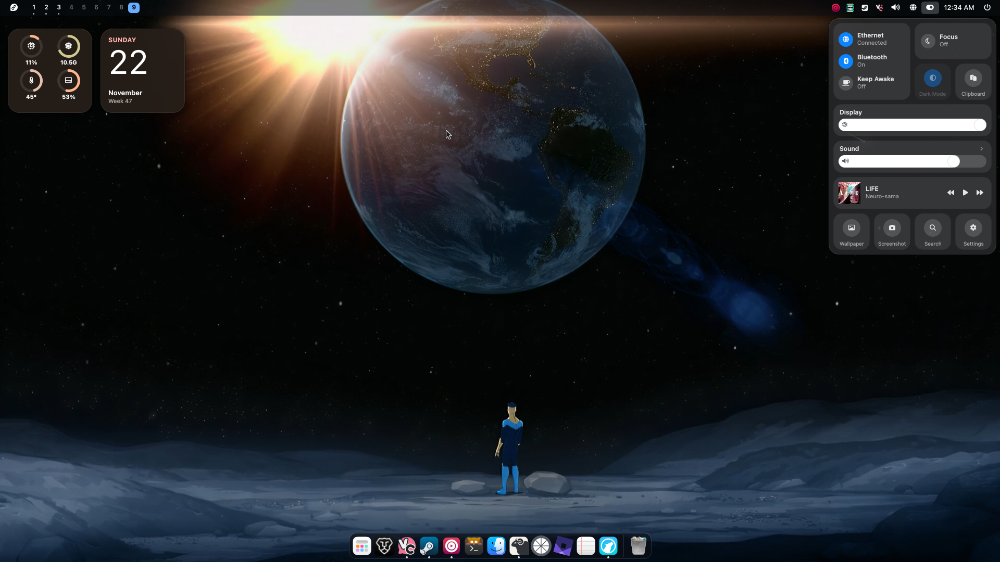

# Control Centre and menus



- `popouts/ControlCenter.qml`: Wi-Fi, Bluetooth, sound, brightness, media, DND, caffeine
- `popouts/SoundMenu.qml`, `NetworkMenu.qml`, `BluetoothMenu.qml`: per-device menus
- `popouts/Power.qml`: Lock, Sleep, Log Out, Restart, Shut Down
- `popouts/SystemMenu.qml`: the logo menu
- `popouts/Media.qml`, `Clipboard.qml`, `Forecast.qml`, `TrayMenu.qml`, `AppMenu.qml`: the rest

Open with:

```sh
qs -c island ipc call menu controls
qs -c island ipc call menu power
qs -c island ipc call menu sound
qs -c island ipc call menu network
qs -c island ipc call menu close
```

Power actions call `scripts/island-power`; see [Non-systemd](../non-systemd.md). The clipboard menu needs `cliphist` and `wl-clipboard`. Brightness needs `ddcutil` and a DDC/CI capable monitor.

Settings that feed these menus are in `defaults.json` and the matching Settings pages.
