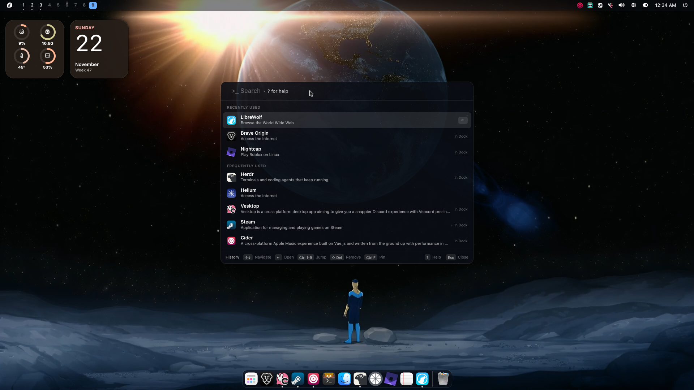

# Spotlight and Launchpad



- `island-spotlight` (Rust, `rust/`): apps, files, math, `>` shell commands, web
  search, history and the bar-skin switcher. Reads `~/.config/island/settings.json`
  and the active theme, so it follows every bar layout.
- `overlays/Launchpad.qml`: the full app grid.
- `services/Apps.qml`: desktop-entry index, search and launch counts.
- `services/SpotHistory.qml`: `~/.local/state/island/spotlight.json` (also used by
  the Rust Spotlight).

IPC:

```sh
qs -c island ipc call launcher toggle
qs -c island ipc call launcher open
qs -c island ipc call launcher close
qs -c island ipc call launchpad toggle
qs -c island ipc call menu launcher
```

The Rust Spotlight is created on open and exits on close. It positions itself
from the active bar: top for the menu bar and capsule skins, bottom for the bottom
and compact bars, or a floating card when selected in Settings → Spotlight.
`spotlightStyle`, `spotlightWidth`, `spotlightRows`, `spotlightFiles`,
`spotlightCommands` and `spotlightWeb` are the relevant settings.

History and launch counts live under `~/.local/state/island/`. `Ctrl+F` pins the
selected row; `Shift+Delete` forgets it. Spotlight's `>` mode runs the command with
a shell in `$HOME`.

Bind them from your compositor with the commands above; the shipped examples use
Super+D and Super+A. See [Keybinds](../keybinds.md).
