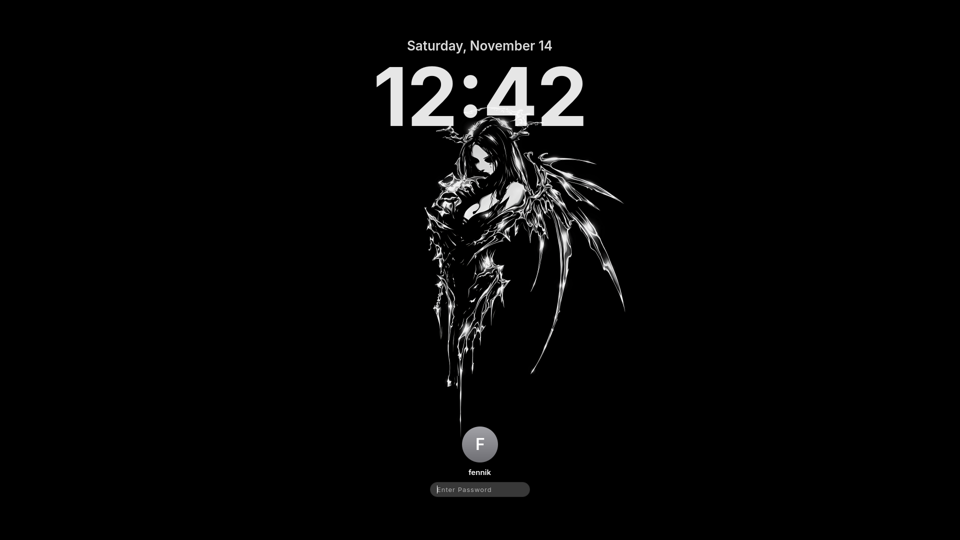

# Lock screen



`overlays/Lock.qml` and `overlays/LockContent.qml` implement an ext-session-lock locker. The compositor keeps the session locked if Island crashes. Authentication uses PAM's `login` stack.

- Config: `overlays/Lock.qml`, `services/LockState.qml`
- Settings: Desktop & Widgets > Lock Screen
- IPC: `qs -c island ipc call lock <lock|preview|previewOff|status>`

Lock from a keybind or script:

```sh
qs -c island ipc call lock lock
scripts/island-power lock
```

`island-power lock` prefers the running Island instance, then `loginctl lock-session`, then `hyprlock`. The lock screen also listens for logind's `Lock` signal when `XDG_SESSION_ID` is set. On a system without logind/elogind, use `island-power lock`.

`preview` shows the lock screen without locking; click or press Escape to close. Settings can switch the locker to `hyprlock`; `apply-theme.sh` writes `~/.config/hypr/hyprlock.conf`.

The picture is read from `~/.face.icon`, `~/.face` or AccountsService. The wallpaper is the current Island wallpaper, or a video's poster frame.
