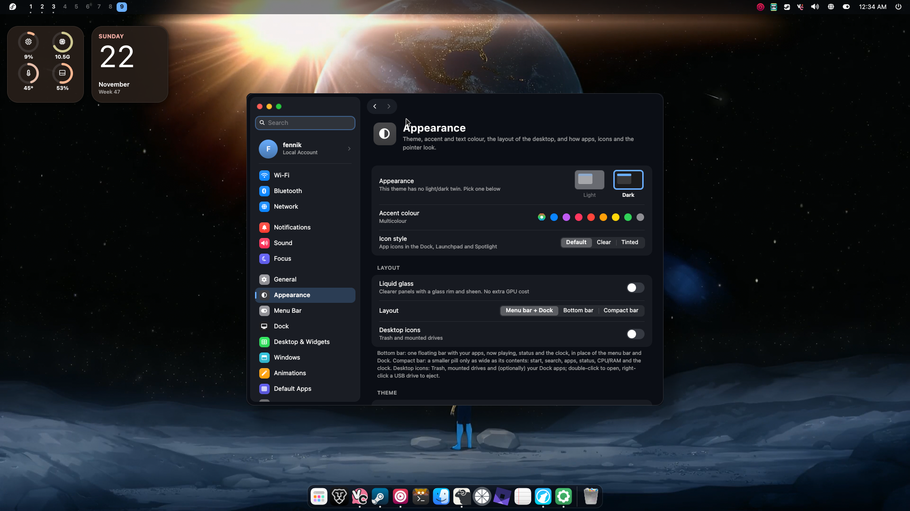

# System Settings



`settings/SettingsWindow.qml` defines the macOS-style window and every page as data. The panes are in `settings/pages/`. Changes apply as you make them.

- Config: `settings/`, `defaults.json`
- User settings: `~/.config/island/settings.json`
- IPC: `qs -c island ipc call settings <toggle|open|close|page NAME|set KEY VALUE|get KEY>`

Examples:

```sh
qs -c island ipc call settings page appearance
qs -c island ipc call settings set gapsIn 8
qs -c island ipc call settings get theme
```

`services/Config.qml` merges `defaults.json` with the user file and runs `apply-settings.sh` about half a second after the last edit. `apply-settings.sh` writes compositor, GTK, Foot and cursor settings; files headed `Generated by` must not be edited by hand.

The window is destroyed 20 seconds after closing. If a hot reload happens while it is open, the Compositor singleton can be temporarily undefined and the pages can appear empty. Reload once with `qs -c island ipc call shell reload`, or restart the shell, and it recovers. See [Troubleshooting](../troubleshooting.md).
