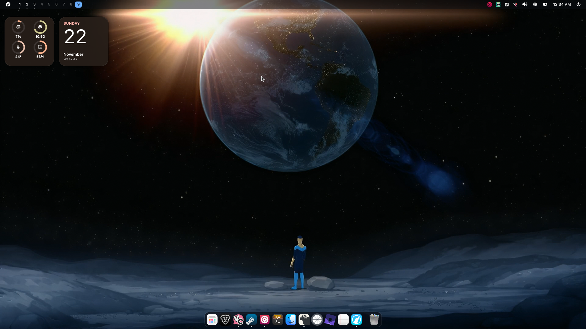
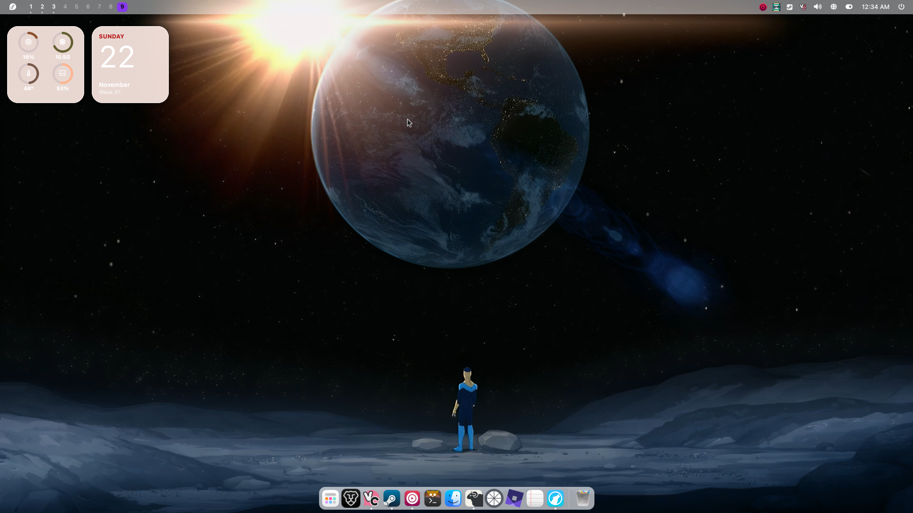

# Theming





Island's palette lives in `themes/<id>.json`. A theme is a small set of colour roles. The shell reads the current theme from `~/.local/state/island/theme`, and `apply-theme.sh` writes the same palette into every app it knows about.

## Palette format

```json
{
  "name": "Orchid", "dark": true,
  "bg": "#16151b", "bg_alt": "#1d1c23",
  "surface": "#26242e", "overlay": "#34313f",
  "fg": "#ecebf2", "fg_dim": "#a09dab", "fg_faint": "#625f6e",
  "accent": "#c2a4ff", "accent_fg": "#17131f",
  "red": "#ff6b81", "green": "#6fd6a8", "yellow": "#f4c97a",
  "blue": "#83aaff", "magenta": "#d8a1ff", "cyan": "#75d7e6"
}
```

- `dark` decides light or dark GTK, Kvantum and Chromium variants.
- `bg` is the window background, `bg_alt` a raised surface, `surface` the card colour, `overlay` separators and borders.
- `fg`, `fg_dim` and `fg_faint` are the three text levels.
- `accent` and `accent_fg` are used for selections, focus rings, active borders and the active tab.
- `red`, `green`, `yellow`, `blue`, `magenta`, `cyan` are semantic colours for widgets and terminals.

There are 21 themes: `abyss`, `aurora`, `catppuccin-latte`, `catppuccin-macchiato`, `catppuccin-mocha`, `e-ink`, `e-ink-light`, `ember`, `everforest`, `gruvbox`, `kanagawa`, `macos`, `macos-light`, `matugen`, `neon-dusk`, `nord`, `orchid`, `rose-pine`, `sakura`, `space`, `tokyo-night`.

## Apply a theme

```sh
./apply-theme.sh orchid       # apply by id
./apply-theme.sh --restore    # re-apply the saved id
```

The shell also calls this when you pick a theme in Settings > Appearance or `qs -c island ipc call picker themes`. The palette is saved to `~/.local/state/island/theme`.

## What `apply-theme.sh` touches

| Target | Output | When it updates |
|---|---|---|
| GTK 3 | `~/.local/share/themes/Island[-dark]/` generated from adw-gtk3 | live, through a GTK theme-name reload |
| GTK 4 | marked block in `~/.config/gtk-4.0/gtk.css` | live for new windows, GTK 4 apps may need a restart |
| Kvantum | `~/.config/Kvantum/Island/` | new Qt windows |
| Hyprland | `~/.config/hypr/theme.lua` plus a live `hyprctl eval` | live |
| MangoWC | `~/.config/mango/theme.conf` plus `mmsg dispatch reload_config` | live |
| niri | `~/.config/niri/island-theme.kdl` | live after niri reloads its include |
| Sway/Scroll | `~/.config/sway/island-theme.conf` plus live `swaymsg` | live |
| Foot | `~/.config/foot/themes/island` | new terminals |
| kitty | `~/.config/kitty/themes/island.conf` | live, `SIGUSR1` reload |
| hyprlock | `~/.config/hypr/hyprlock.conf` | next lock |
| btop | `~/.config/btop/themes/island.theme` | next launch |
| cava | `~/.config/cava/themes/island` | next launch |
| Vesktop | `~/.config/vesktop/themes/island.theme.css` | live |
| Herdr | `~/.config/herdr-app/themes/island.json` | live |
| VSCodium | local Island theme extension | live |
| Steam | Millennium Material Theme colour file | live |
| Brave, Helium, Chromium | `BrowserThemeColor` policy in `/etc/{brave,chromium}/policies/managed/island.json` | live after a few seconds |
| Brave new tab | profile preferences | next Brave start |
| LibreWolf | `chrome/island-colors.css` and Sidebery `userContent.css` | next start |
| Neovim | running instances get `SIGUSR1`; colours come from `matugen.lua` | live |

Files written by the scripts contain a `Generated by quickshell/island/apply-theme.sh` header. Do not hand-edit them. Change the palette, or the generator.

## Add a theme

1. Copy an existing file: `cp themes/orchid.json themes/mytheme.json`.
2. Edit the colours and set a unique `"name"`.
3. Keep the file name lowercase, since the id is the file name without `.json`.
4. Pick it in Settings. New files appear without a restart.

The picker lists every `themes/*.json`. `themes/matugen.json` is generated by `scripts/matugen-theme.sh` and is overwritten whenever Material You colours are rebuilt.

## Material You

Settings > Appearance > Match the wallpaper uses `scripts/matugen-theme.sh`. It reads `matugenScheme`, `matugenMode` and `matugenPrefer` from `~/.config/island/settings.json`, runs `matugen image` in dry-run JSON mode, writes `themes/matugen.json`, and applies it. Video wallpapers use their cached poster frame. `apply-theme.sh` does not call matugen by itself.

## State and overrides

- Current theme id: `~/.local/state/island/theme`.
- Theme paired wallpapers: `~/.config/island/theme-walls.json`.
- GTK theme choice: `~/.config/island/settings.json` (`gtkTheme`); `auto` means the generated Island theme.
- Window/widget colour overrides live in Settings; they are not palette keys.

## Sidebery

Firefox and Sidebery do not read GTK colours through userChrome. `apply-theme.sh` finds each LibreWolf profile's Sidebery UUID and writes `~/.config/librewolf/<profile>/chrome/island-content.css` with the `--s-*` variables Sidebery exposes. It is imported by `userContent.css`, so the vertical tabs follow the palette. Restart LibreWolf after a theme change.
